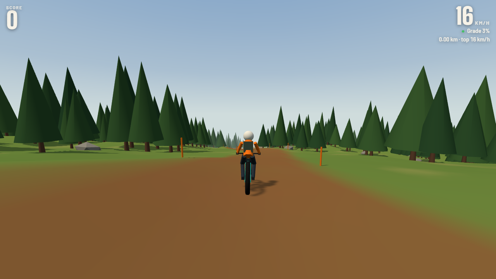

# Cedar Drop

[](https://github.com/Ashen00001/cedar-drop/actions/workflows/ci.yml)  

An endless freeride downhill mountain bike game that runs in the browser. One mountain, one dirt line down it, and a pile of kickers, tables, gaps and rollers to send. Throw flips and spins, tweak the bike, chain it into a combo, and keep it off the trees.

**[Play it](https://ashen00001.github.io/cedar-drop/)**



## Controls

Works with a gamepad or the keyboard.

| | Gamepad | Keyboard |
|---|---|---|
| Pedal / brake | RT / LT | `W` / `S` |
| Steer, lean | Left stick | `A` `D`, `Q` `E` |
| Flip and spin in the air | Left stick | `W` `S`, `A` `D` |
| Crouch, release to hop | Hold `A` | `Space` |
| Tricks in the air | Right stick (8 directions) | Arrow keys |
| Respawn / camera / pause | `Y` / Back / Start | `R` / `C` / `Esc` |

Hold crouch up the ramp and let go right at the lip for big air. Pump the rollers: crouch going up, release on the back side. Land pointed where you're going. `F3` shows a controller debug readout, and `M` mutes.

## How it works

The whole game is about 1,100 lines of TypeScript on top of [three.js](https://threejs.org). There are no art or audio assets: the terrain is generated, the bike and rider are built from primitives, and the sound is synthesized with the Web Audio API.

- **Bike physics** (`src/physics.ts`): a custom rigid-body model stepped at a fixed 100 Hz. Each wheel casts seven rays into the terrain and gets a spring-damper contact force. The bike's orientation is a quaternion, so flips and spins have no gimbal lock. Grip falls off as you slide, steering is a bicycle model, and landing is predicted ahead of time so the bike levels out toward the slope.
- **Terrain** (`src/world.ts`, `src/render/terrain.ts`): a heightfield from seeded Perlin noise, with the trail carved in along a sum of sines. Jump features repeat down the mountain: rollers, kickers, tables and gaps. It streams in 64 m chunks, and trees and rocks are drawn as instanced meshes, scattered deterministically per grid cell.
- **Tricks and scoring** (`src/tricks.ts`): flips and spins score quadratically, there are eight tweaks, and the combo multiplier caps at 8x. Repeating the same trick pays less, and a bail wipes the combo. Land cleanly to bank it.
- **Bail ragdoll** (`src/render/ragdoll.ts`): the rider and bike separate on a crash and tumble separately.
- **Everything is seeded**, so a run is reproducible. That is what makes the physics testable.

## Development

```bash
npm install
npm run dev        # http://localhost:5173
npm run typecheck  # tsc, strict mode
npm test           # vitest
npm run build      # production build into dist/
```

Open the dev server with `#autoride` on the end (`http://localhost:5173/#autoride`) to let an autopilot ride the trail.

The tests cover the noise functions, the world generator (determinism, continuity, normals, feature placement), trick scoring and banking, and the bike simulation, including a 20 second autopilot ride that checks every state value stays finite.

CI runs the typecheck, the tests and the build on every push, and deploys `main` to GitHub Pages.

## License

[MIT](LICENSE)
